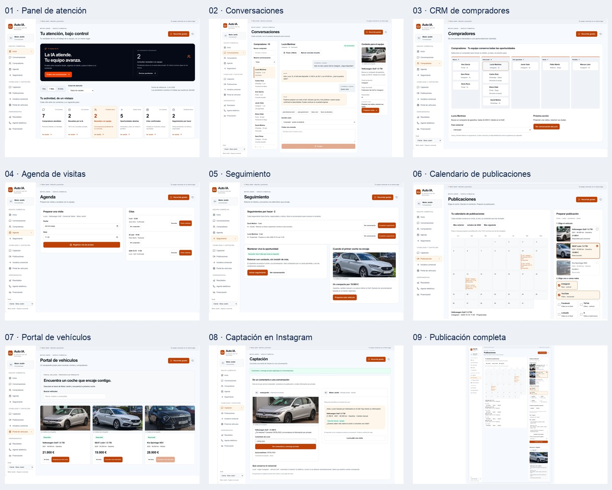
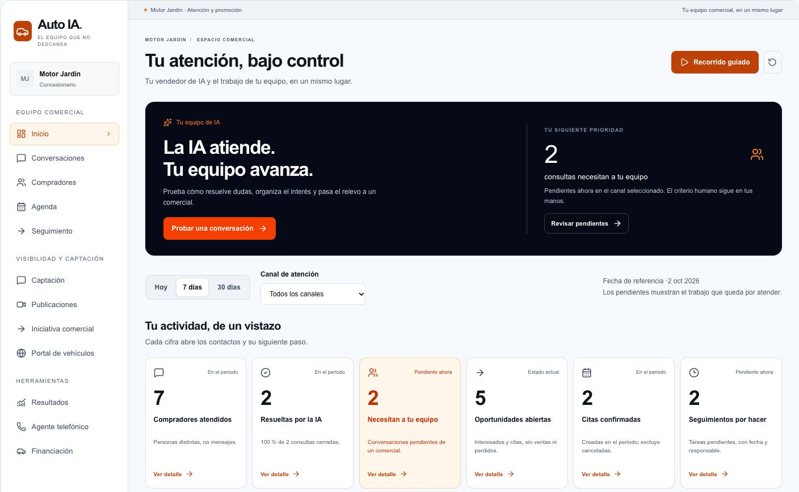
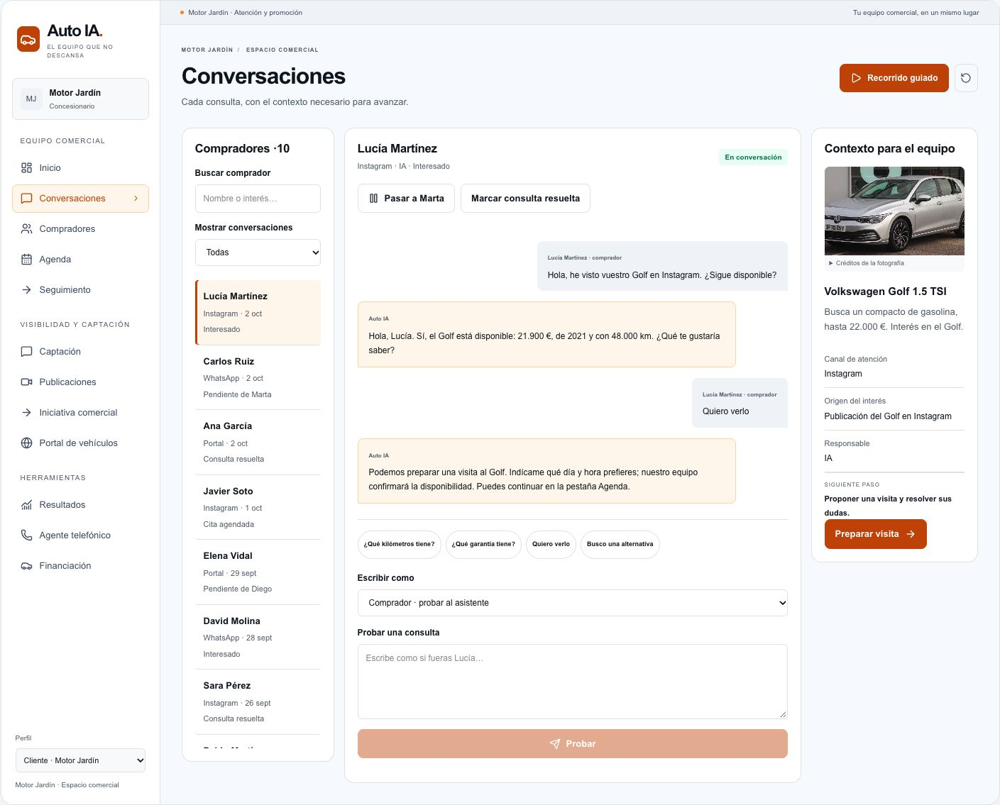
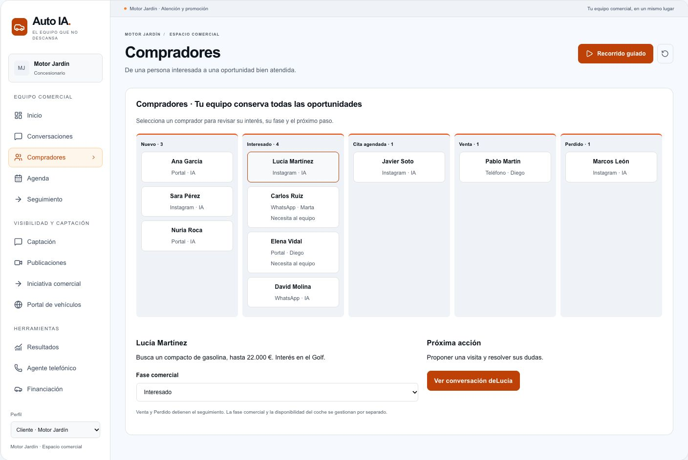
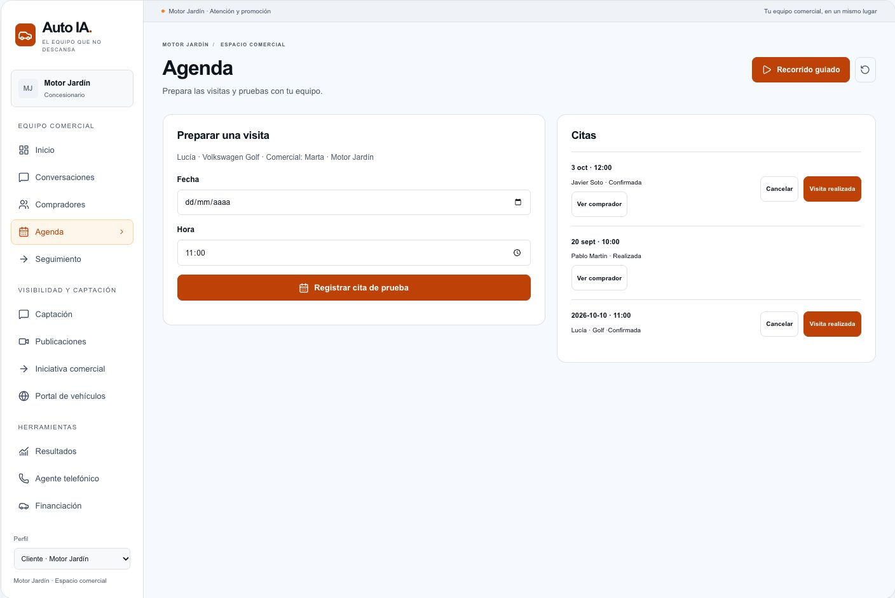
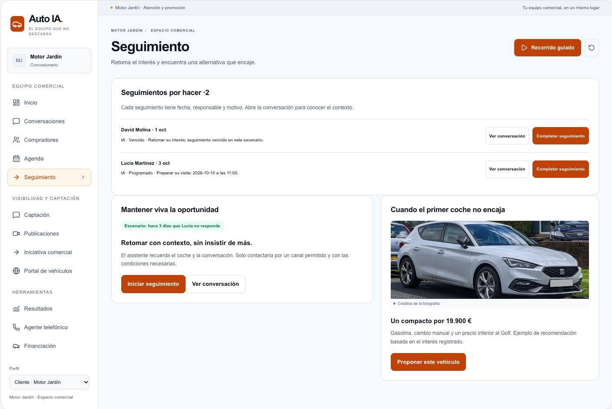
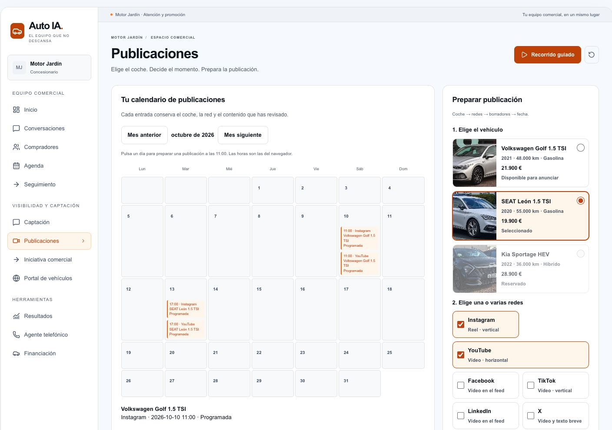
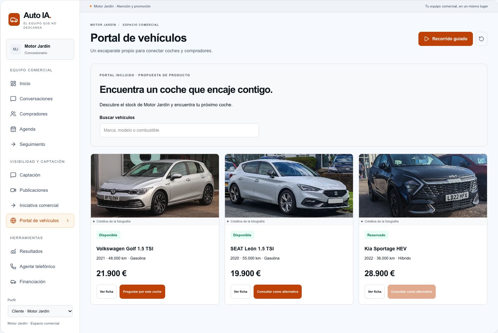
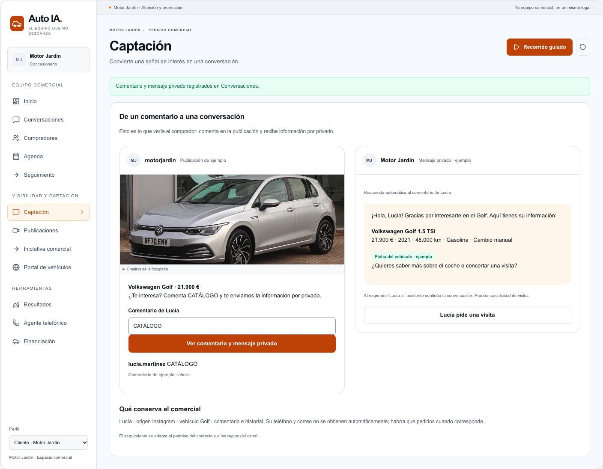
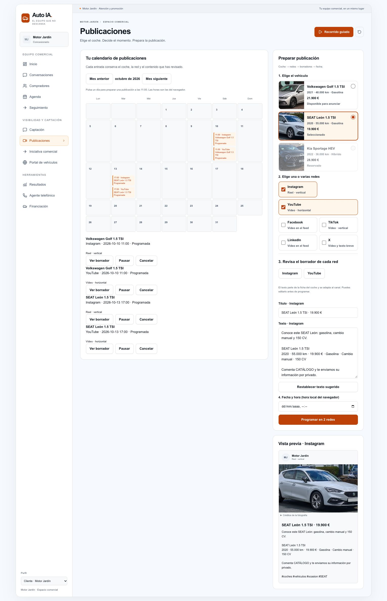

# Auto IA — capturas para el vídeo de lanzamiento

Capturas auténticas de la interfaz del recorrido comercial de Auto IA, tomadas el 9 de octubre de 2026. Los archivos se pueden descargar sin iniciar sesión.

## Enlaces directos

| Imagen | Tamaño | Archivo accesible |
| --- | --- | --- |
| Panel de atención | 1408 × 870 | [01-panel-atencion.jpg](https://raw.githubusercontent.com/Hostmate/auto-ia-launch-video-assets/main/01-panel-atencion.jpg) |
| Conversaciones | 1409 × 1135 | [02-conversaciones.jpg](https://raw.githubusercontent.com/Hostmate/auto-ia-launch-video-assets/main/02-conversaciones.jpg) |
| CRM de compradores | 1408 × 943 | [03-crm-compradores.jpg](https://raw.githubusercontent.com/Hostmate/auto-ia-launch-video-assets/main/03-crm-compradores.jpg) |
| Agenda de visitas | 1408 × 943 | [04-agenda-visitas.jpg](https://raw.githubusercontent.com/Hostmate/auto-ia-launch-video-assets/main/04-agenda-visitas.jpg) |
| Seguimiento | 1408 × 943 | [05-seguimiento.jpg](https://raw.githubusercontent.com/Hostmate/auto-ia-launch-video-assets/main/05-seguimiento.jpg) |
| Calendario de publicaciones | 1408 × 990 | [06-calendario-publicaciones.jpg](https://raw.githubusercontent.com/Hostmate/auto-ia-launch-video-assets/main/06-calendario-publicaciones.jpg) |
| Portal de vehículos | 1408 × 943 | [07-portal-vehiculos.jpg](https://raw.githubusercontent.com/Hostmate/auto-ia-launch-video-assets/main/07-portal-vehiculos.jpg) |
| Captación en Instagram | 1408 × 1096 | [08-captacion-instagram.jpg](https://raw.githubusercontent.com/Hostmate/auto-ia-launch-video-assets/main/08-captacion-instagram.jpg) |
| Publicación completa | 1531 × 2370 | [09-publicacion-completa.jpg](https://raw.githubusercontent.com/Hostmate/auto-ia-launch-video-assets/main/09-publicacion-completa.jpg) |

## Uso para producción audiovisual

- Mantener la interfaz auténtica: animar con acercamientos, encuadres y transiciones; no inventar pantallas, botones, métricas, testimonios ni resultados.
- La captura 09 es larga y está pensada para extraer distintos planos; no reducirla entera a un fotograma ilegible.
- Motor Jardín, los compradores, las conversaciones y las cifras son el escenario de presentación. No contienen datos privados de concesionarios o compradores reales.
- Las imágenes muestran el recorrido comercial y no certifican que sus conexiones, mensajes, citas, campañas o portal se ejecuten en servicios externos.
- La vista de captación es una pantalla propia de Auto IA inspirada en Instagram; no es una captura de la aplicación de Instagram.
- Las fotografías de los coches conservan su licencia y atribución. Consultar [los créditos](CREDITOS_FOTOGRAFIAS.md) y mantenerlos en las producciones derivadas.
- Esta colección contiene referencias visuales. No incluye un vídeo renderizado ni un guion aprobado.

## Capturas individuales

### Panel de atención

Panel, prioridades y KPIs. Las cifras pertenecen al escenario de presentación; no son resultados comerciales.

### Conversaciones

Conversación del Golf con petición de visita y contexto para el equipo.

### CRM de compradores

Fases de compradores y próxima acción.

### Agenda de visitas

Preparación de visita y citas registradas en el escenario.

### Seguimiento

Seguimientos y recomendación de un vehículo alternativo.

### Calendario de publicaciones

Selección visual del coche y calendario con Instagram y YouTube.

### Portal de vehículos

Vista de escaparate de vehículos incluida en la propuesta.

### Captación en Instagram

Vista de ejemplo inspirada en Instagram: comentario CATÁLOGO y mensaje privado.

### Publicación completa

Captura larga con selección de redes, borrador editable y vista previa. Usar acercamientos a regiones concretas.

